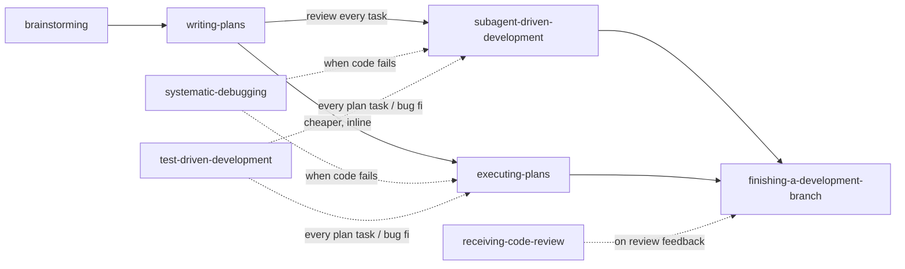

# omp-superpowers

A brainstorm → plan → execute → finish development workflow for [OMP](https://github.com/can1357/oh-my-pi),
adapted from [obra/superpowers](https://github.com/obra/superpowers). Skills carry the process; task agents
routed through OMP model roles do the per-task implementation and review so cheap models handle mechanical
work and the most capable model is spent only where judgment matters.

## Install

```text
/marketplace add <owner>/<marketplace-repo>      # or a local path to the marketplace checkout
/marketplace install omp-superpowers@magrathea
```

CLI equivalent: `omp plugin marketplace add <source>` then `omp plugin install omp-superpowers@magrathea`.
Start a new session afterwards; skills and agents are discovered at startup.

Do not install this alongside upstream Superpowers: both ship skills named `brainstorming`, `writing-plans`, etc.,
and OMP would namespace one copy.

## Workflow



| Skill | Triggers when |
|---|---|
| `brainstorming` | Larger work (new feature, subsystem, or project; multi-file behavior change with unsettled requirements) or when you ask to brainstorm/design. Small, fully specified changes skip it. |
| `writing-plans` | A design/spec is approved or you ask for an implementation plan. |
| `subagent-driven-development` | Executing an approved plan with a fresh implementer and reviewer per task. |
| `executing-plans` | Executing an approved plan inline in the session, one final review. |
| `finishing-a-development-branch` | Implementation is complete and tests pass; presents merge / PR / keep options. |
| `test-driven-development` | Bug fixes and approved-plan tasks only; other work follows OMP's normal test policy. |
| `systematic-debugging` | Any bug, test failure, or unexpected behavior, before proposing fixes. |
| `receiving-code-review` | Review feedback arrives, before implementing suggestions. |

## Agents and model roles

Agents select models through OMP model-role aliases, so your role mapping decides the concrete model.

| Agent | Model role | Used for |
|---|---|---|
| `sp-planner` | `@plan`, then `@slow` | Writes the plan document from an approved spec (project-sized work) |
| `sp-builder-check` | `@task` | Reads a design doc as the builder who must plan from it |
| `sp-implementer-fast` | `@smol` | Mechanical tasks: plan text has the complete code, or a single-file mechanical fix |
| `sp-implementer` | `@task` | Default implementer for prose-specified or multi-file tasks |
| `sp-implementer-strong` | `@slow` | Design-judgment tasks; fix-loop escalation |
| `sp-task-reviewer` | `@task` | Per-task spec-compliance and code-quality review |
| `sp-re-reviewer` | `@task` | Scoped re-review of fix diffs |
| `sp-final-reviewer` | `@slow` | Whole-branch final review |

Assign roles with `/model` (Roles view) or `modelRoles` in `~/.omp/agent/config.yml`. Override one agent without
touching others via `task.agentModelOverrides` (for example `sp-implementer: "@slow"`).

## Policies

User and repository instructions (AGENTS.md and similar) override these skills.

- **Git:** work happens on a task branch, never the base branch, and is committed locally as it progresses. Every plan
  header has a `**Git:**` line; if your instructions don't already make task-branch commits the default, approving the
  plan authorizes them. Push, PR creation, merge, branch deletion, and worktree
  removal each need your explicit choice in `finishing-a-development-branch`. Merges use `git merge --no-ff`; the
  base is synchronized with `git pull --ff-only` when it has an upstream; force-push is never used.
- **Worktrees:** created only when your instructions call for one or the tree holds unrelated uncommitted work.
- **Artifacts:** specs in `docs/superpowers/specs/`, plans in `docs/superpowers/plans/`, and per-plan scratch
  (ledger, task briefs, reports, review packages) in the self-ignoring `.superpowers/sdd/<plan>/`.

## Developing

Marketplace installs run from a cached copy. After editing a local checkout, reinstall with
`omp plugin install --force omp-superpowers@magrathea` and start a new session.

See [UPSTREAM.md](UPSTREAM.md) for the pinned upstream commit and every deliberate deviation.

## License

MIT. Original work © 2025 Jesse Vincent; adaptations © 2026 Martin Rojas. See [LICENSE](LICENSE).
